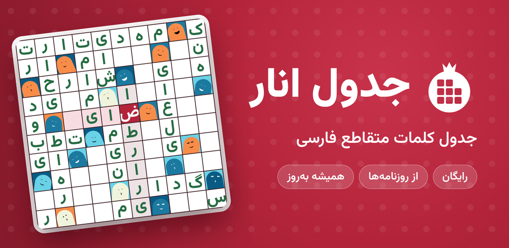
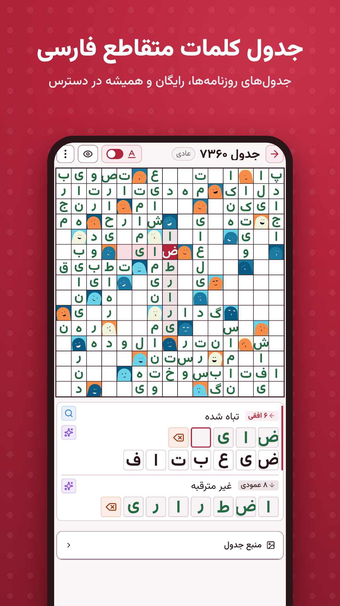
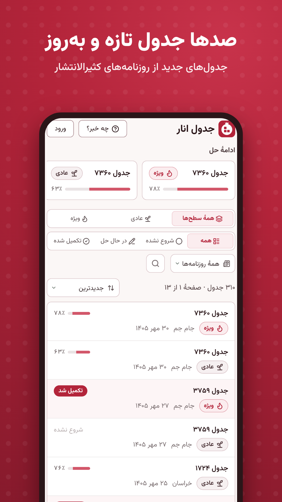
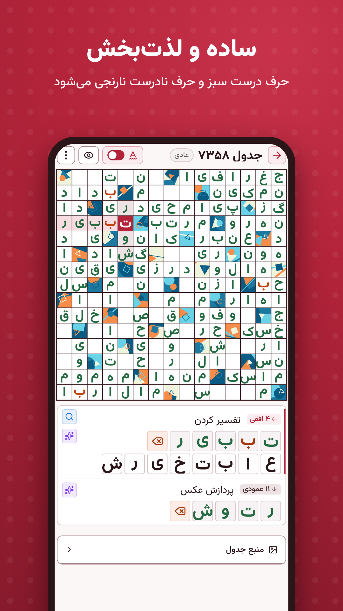
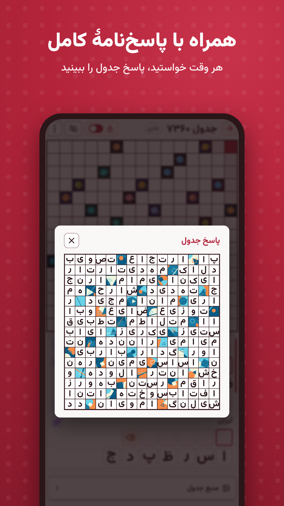
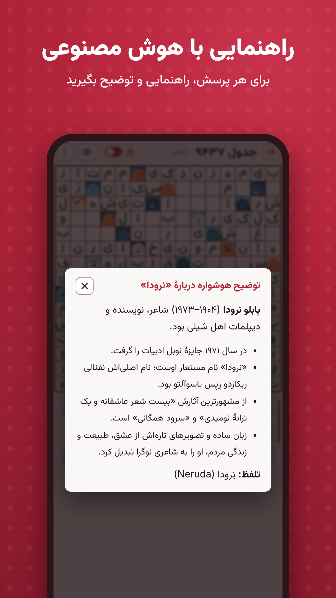
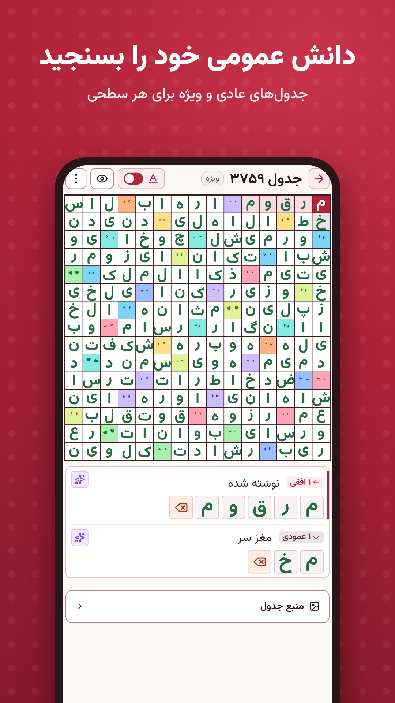

  

  
  
  
  

  
  
  
  
  
  

# جدول انار

جدول کلمات متقاطع فارسی؛ رایگان، برگرفته از روزنامه‌ها و همیشه به‌روز.

با مجموعه‌ای جذاب از جدول‌های کلمات متقاطع فارسی، دانش عمومی و دایرهٔ واژگان خود را به چالش بکشید!
جدول‌های این بازی برگرفته از جدول‌های منتشرشده در روزنامه‌های کثیرالانتشار هستند و تجربه‌ای آشنا و سرگرم‌کننده را برای علاقه‌مندان به حل جدول فراهم می‌کنند.

## دریافت

- **اندروید:** [جدول انار در Google Play](https://play.google.com/store/apps/details?id=com.persiancrossword.app)
- **وب:** [blankuapp.github.io/PersianCrossword](https://blankuapp.github.io/PersianCrossword/) (بدون نصب، روی هر مرورگری)

## ویژگی‌ها

- کاملاً رایگان
- صدها جدول از روزنامه‌هایی مانند جام جم، ایران، خراسان و قدس
- جدول‌های عادی و ویژه برای هر سطحی
- طراحی ساده و کاربرپسند، با کاشی‌های حرف برای حل آسان‌تر
- نمایش حرف‌های درست و نادرست هنگام حل
- پاسخ‌نامهٔ کامل هر جدول
- راهنمایی و توضیح پرسش‌ها با هوش مصنوعی
- ذخیرهٔ پیشرفت و همگام‌سازی آن بین دستگاه‌ها با ورود به حساب
- به‌روزرسانی مداوم و اضافه‌شدن جدول‌های جدید

## تصویرها

  
  
  

  
  
  

## مجوز

این پروژه تحت مجوز [MIT](LICENSE) منتشر شده است.

